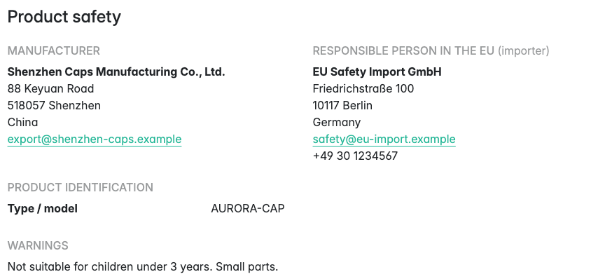
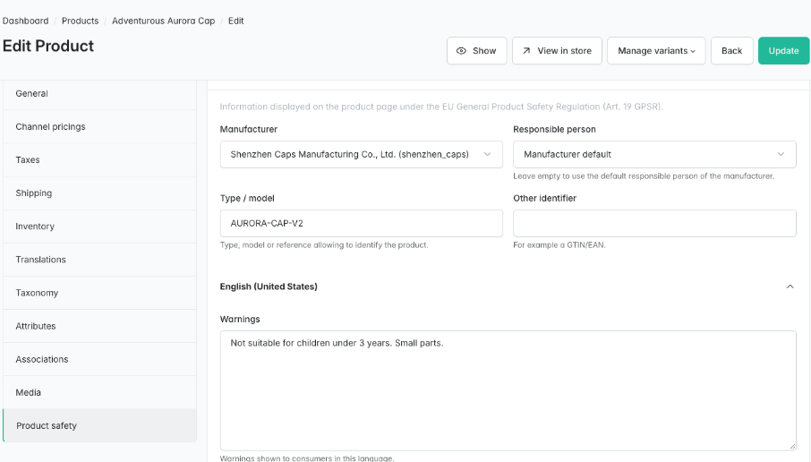

# Sylius GPSR Plugin

**EU General Product Safety Regulation (GPSR) information on your Sylius 2 product pages.**

Since **13 December 2024**, every online shop selling consumer products in the European Union
must show, in each product offer, the manufacturer, the EU responsible person when the
manufacturer is established outside the Union, product identification and warnings or safety
information ([Article 19 of Regulation (EU) 2023/988][gpsr]).

This plugin adds that data to Sylius 2.2+ and displays it on the product page, free and open
source.

## Features

| Requirement (Art. 19 GPSR) | What the plugin does |
|---|---|
| (a) Manufacturer name, registered trade name or trade mark, postal and electronic address | *Manufacturers* back office (name, trade mark, address, country, e-mail, website), linked to products |
| (b) EU responsible person when the manufacturer is not established in the Union | *Responsible persons* back office (importer, authorised representative or fulfilment service provider, EU address required); default per manufacturer, override per product; warnings when missing |
| (c) Product identification: picture, type, other identifier | Sylius product images + *type / model* and *other identifier* (e.g. GTIN/EAN) per product |
| (d) Warnings and safety information in the consumer's language | Translatable *warnings* and *safety information* per product, with fallback to the default locale |
| Clearly and visibly, in the offer | *Product safety* section rendered on the product page itself, no click needed; nothing rendered when a product has no data |

Also included:

- **Product form tab**: a *Product safety* tab on the admin product create and edit pages. Your
  `Product` entity is **not** modified (the plugin owns the one-to-one relation).
- **Compliance helpers**: *Outside EU* badges, a warning on non-EU manufacturers without a
  responsible person (saving is never blocked), and a **"GPSR data missing" filter** on the
  admin products grid.
- **Translations** in English, French, German, Spanish, Italian, Dutch and Polish.
- **Demo fixtures** (`tmonier_gpsr_responsible_person`, `tmonier_gpsr_manufacturer`,
  `tmonier_gpsr_product_safety`).
- **Customisable** through Twig Hooks and resource class overrides; MySQL, MariaDB and
  PostgreSQL support.

## Screenshots





## Requirements

| | Version |
|---|---|
| PHP | 8.2+ |
| Sylius | 2.2, 2.3 |
| Symfony | 6.4, 7.4, 8.0 |

## Installation

1. Require the package:

    ```bash
    composer require tmonier/sylius-gpsr-plugin
    ```

2. Register the bundle in `config/bundles.php` (Symfony Flex does it automatically once a recipe exists):

    ```php
    Tmonier\SyliusGpsrPlugin\TmonierSyliusGpsrPlugin::class => ['all' => true],
    ```

3. Import the configuration in `config/packages/tmonier_sylius_gpsr.yaml`:

    ```yaml
    imports:
        - { resource: "@TmonierSyliusGpsrPlugin/config/config.yaml" }
    ```

4. Import the admin routes in `config/routes/tmonier_sylius_gpsr.yaml`:

    ```yaml
    tmonier_sylius_gpsr:
        resource: "@TmonierSyliusGpsrPlugin/config/routes.yaml"
    ```

5. Run the migrations:

    ```bash
    bin/console doctrine:migrations:migrate
    ```

6. In the back office, create your responsible persons and manufacturers under
   **Catalog → Responsible persons / Manufacturers**, then fill the **Product safety** tab of
   each product. Use the **GPSR data missing** filter of the products grid to find the gaps.

## Configuration

There is nothing to configure. Every resource can be extended like any Sylius resource:

```yaml
# config/packages/tmonier_sylius_gpsr.yaml
tmonier_sylius_gpsr:
    resources:
        manufacturer:
            classes:
                model: App\Entity\Gpsr\Manufacturer          # extends Tmonier\SyliusGpsrPlugin\Entity\Manufacturer
        responsible_person:
            classes:
                model: App\Entity\Gpsr\ResponsiblePerson
        product_safety:
            classes:
                model: App\Entity\Gpsr\ProductSafety
            translation:
                classes:
                    model: App\Entity\Gpsr\ProductSafetyTranslation
```

"Established in the EU" means one of the 27 Member States
(`Tmonier\SyliusGpsrPlugin\Model\EuMemberStates`). Iceland, Liechtenstein and Norway (EEA) are
deliberately not included.

### Demo data

```bash
bin/console sylius:fixtures:load tmonier_gpsr -n
```

with a suite such as the one in [`tests/TestApplication/config/config.yaml`](tests/TestApplication/config/config.yaml).

## Customisation

The shop and admin parts are built with [Twig Hooks](https://stack.sylius.com/twig-hooks/getting-started):

| Hook | Content |
|---|---|
| `sylius_shop.product.show.content.info.overview` → `tmonier_gpsr_product_safety` | *Product safety* section of the product page |
| `sylius_admin.product.{create,update}.content.form.side_navigation` → `tmonier_gpsr_product_safety` | *Product safety* tab button |
| `sylius_admin.product.{create,update}.content.form.sections` → `tmonier_gpsr_product_safety` | *Product safety* tab content |
| `tmonier_gpsr.admin.manufacturer.{create,update}.content.form.sections.general` | Manufacturer form |
| `tmonier_gpsr.admin.manufacturer.update.content` → `responsible_person_warning` | Missing responsible person warning |
| `tmonier_gpsr.admin.responsible_person.{create,update}.content.form.sections.general` | Responsible person form |

Templates can be overridden in `templates/bundles/TmonierSyliusGpsrPlugin/`. To display the data
elsewhere (cart, PDF, feeds), use the Twig function or the resolver service:

```twig


    {{ safety.manufacturer.name }} – {{ safety.manufacturer.email }}

```

```php
public function __construct(private ProductSafetyResolverInterface $resolver) {}

$view = $this->resolver->resolve($product, 'de_DE'); // ?ProductSafetyView
```

> [!IMPORTANT]
> If you move or restyle the product safety section, keep it **on the product page itself and
> visible without interaction**: Art. 19 requires the information to be shown clearly and
> visibly in the offer.

## What you still have to do

The plugin displays the information you enter. As an economic operator you remain responsible for:

- entering accurate manufacturer and responsible person data, and **warnings and safety
  information in the languages of the Member States you sell to**;
- the product itself: labelling on the product or packaging, instructions, technical
  documentation, internal risk assessment, traceability (batch / serial numbers);
- product safety incidents, recalls and notifications through the Safety Business Gateway;
- sector-specific rules (toys, cosmetics, electrical equipment, etc.) that may require more
  information online;
- reviewing products created or imported outside the admin form (API, imports): the *GPSR data
  missing* filter helps.

This plugin is not legal advice.

## Development

```bash
docker compose up -d mysql   # or your own MySQL
composer install
(cd vendor/sylius/test-application && yarn install && yarn build)
vendor/bin/console doctrine:database:create
vendor/bin/console doctrine:migrations:migrate -n
vendor/bin/console sylius:fixtures:load -n
vendor/bin/console sylius:fixtures:load tmonier_gpsr -n

vendor/bin/phpunit --testsuite unit
APP_ENV=test vendor/bin/phpunit --testsuite non-unit   # needs a test database with fixtures
vendor/bin/phpstan analyse
vendor/bin/ecs check
```

## License

MIT. See [LICENSE](LICENSE).

[gpsr]: https://eur-lex.europa.eu/legal-content/EN/TXT/HTML/?uri=CELEX:32023R0988
